# Python Quiz Game

Python 3 기반 터미널 객관식 퀴즈 게임입니다. 클래스 설계, 입력 검증, JSON 영속화, Git 브랜치 협업 흐름을 연습하기 위해 제작했습니다.

## 과제 목표 및 개발 환경

Python 기초 문법을 실제 프로그램에 적용하고, 클래스와 객체의 역할을 이해하며, 파일 입출력과 예외 처리를 학습하는 것이 목표입니다. Git을 이용한 버전 관리 및 원격 저장소 복제·갱신도 실습했습니다.

| 구분 | 사용 환경 |
|---|---|
| 언어 | Python 3 |
| 편집기 | Visual Studio Code |
| 운영체제 및 터미널 | Windows / PowerShell |
| 버전 관리 | Git / GitHub |
| 저장 형식 | JSON |

## 1. 실행 및 기능

```powershell
python main.py
```

메뉴: **1 퀴즈 풀기 / 2 퀴즈 추가 / 3 퀴즈 목록 / 4 최고 점수 / 5 저장 후 종료**.

- 기본 문제: **5문제**. 실행 후 메뉴 `3`에서 기본 문제 목록과 개수를 직접 확인할 수 있습니다. 사용자 추가 문제는 저장 파일에 따라 개수가 늘어납니다. 실제 문제 문구는 `main.py`의 `questions_data`가 기준입니다.
- 각 문제에는 보기 4개와 정답 번호(1~4)가 있습니다.
- 문제와 보기 입력 중 `q`를 입력하면 추가 작업을 취소하고 메뉴로 돌아갑니다.
- 최고 점수를 기록하며, 정상 종료 시 문제 목록과 최고 점수를 JSON에 저장합니다.

### 프로젝트 파일 구조

```text
python-w/
├── main.py           # 게임 실행 및 주요 기능
├── README.md         # 프로젝트 설명 및 실습 기록
├── state.json        # 문제 목록과 최고 점수 저장
├── .gitignore        # Git 추적 제외 설정
├── git-evidence.txt  # Git 실습 기록
└── screenshots/     # 실습 화면 증빙
```

## 2. 구조와 역할 분리

| 구성 요소 | 책임 | 변경할 때 확인할 곳 |
|---|---|---|
| `Quiz` | 한 문제의 질문, 보기, 정답을 보관하고 출력·채점 | `Quiz.__init__`, `display`, `check_answer` |
| `QuizGame` | 문제 목록, 최고 점수, 문제 추가, 저장·불러오기 관리 | `show_quiz_list`, `show_best_score`, `update_best_score`, `add_quiz`, `save_state`, `load_state` |
| `play_quiz()` | 문제 순회, 사용자 답변 요청, 점수 집계 | `main.py`의 `play_quiz` |
| 메뉴 함수 | 기능 선택과 잘못된 메뉴 입력 재요청 | `main.py`의 `show_menu` |
| `state.json` | 실행 간 유지할 문제·최고 점수 데이터 | JSON 구조 및 `save_state`/`load_state` |

**클래스를 사용한 이유:** 한 문제의 데이터와 채점 행동을 `Quiz`로 묶고, 여러 문제와 기록 관리를 `QuizGame`으로 묶어 책임을 분리했습니다. 함수만으로도 작은 프로그램을 만들 수 있지만, 클래스는 문제별 상태와 동작을 함께 관리하고 기능 확장 시 수정 범위를 좁히는 데 유리합니다.

**분리 기준:** 입력 검증은 메뉴 및 문제 입력·답변 입력 경계에서 수행하고, 파일 입출력은 `QuizGame.save_state`/`load_state`에 모읍니다. 채점은 `Quiz.check_answer`에 맡깁니다. 이 구조는 잘못된 입력이 게임 데이터에 반영되는 것을 줄이고, 저장 형식 변경이 메뉴 코드 전체에 퍼지는 것을 방지합니다. 다만 현재 구현은 단일 `main.py` 파일이므로 물리적으로 모듈을 분리한 것은 아닙니다.

## 3. JSON 데이터 설계와 저장 정책

예시 구조(실제 문제 문구와 점수는 다를 수 있음):

```json
{
  "quizzes": [
    {
      "question": "예시 질문",
      "choices": ["보기 1", "보기 2", "보기 3", "보기 4"],
      "answer": 2
    }
  ],
  "best_score": 1
}
```

- `quizzes`: 여러 문제를 순서대로 보관하는 배열. 문제별 질문·보기·정답을 객체로 묶어 필드 의미를 명확히 했습니다.
- `question`: 문제 문자열. `choices`: 순서 있는 보기 4개. `answer`: 정답 보기 번호(1~4). `best_score`: 최고 점수 또는 아직 기록이 없을 때 `null`.
- **JSON 선택 이유:** 사람이 읽고 수정하기 쉬우며 Python 표준 라이브러리 `json`으로 처리할 수 있고 별도 DB가 필요 없습니다.
- **장점:** 간단한 구조, 높은 가독성, 작은 프로젝트에서 쉬운 백업·이동. **단점:** 전체 파일을 읽고 다시 쓰므로 데이터가 커질수록 메모리·입출력 부담이 증가하고 동시 수정 및 부분 갱신에 취약합니다. 대규모 문제 은행이나 다중 사용자 환경에서는 SQLite 같은 DB를 검토합니다.
- `STATE_FILE = "state.json"`처럼 상대 경로를 사용하면 **프로그램을 실행한 현재 작업 폴더**에 저장됩니다. 예: 프로젝트 폴더에서 `python main.py` 실행 시 해당 폴더의 `state.json`. 다른 폴더에서 실행하면 저장 위치가 달라질 수 있습니다. 쓰기 권한이 없는 폴더에서는 저장 오류가 날 수 있으므로 쓰기 가능한 프로젝트 폴더에서 실행합니다.
- **현재 저장 정책:** 메뉴 `5`를 통한 정상 종료 시 저장합니다. `Ctrl+C`/EOF 등으로 종료할 경우 마지막 저장 이후의 변경은 보장되지 않습니다. 문제 추가 도중 취소하면 미완성 문제는 등록되지 않습니다. 향후 개선안은 문제 추가 직후 자동 저장, 임시 파일에 쓴 후 교체하는 원자적 저장, 저장 실패 안내입니다. **이 개선안은 현재 구현 완료 기능이 아닙니다.**

### 백업·복구 절차

현재 프로그램은 JSON 파일이 없거나 손상된 경우 기본 퀴즈로 시작하도록 처리하지만, **자동 백업 복구는 구현되어 있지 않습니다.** 중요한 데이터를 보호하려면 다음 수동 절차를 권장합니다.

1. 게임을 정상 종료한 뒤 `state.json`을 `state.backup.json` 등의 이름으로 다른 위치에 복사합니다.
2. 파일 손상 메시지가 나오면 프로그램을 종료합니다. 손상된 `state.json`은 분석용으로 별도 보관합니다.
3. 정상 백업을 `state.json`으로 복원하고 다시 실행해 목록과 최고 점수를 확인합니다.
4. 백업이 없다면 기본 퀴즈로 재시작하며 기존 사용자 추가 문제·기록은 복원되지 않을 수 있습니다.

## 4. 테스트 체크리스트

아래는 재현 가능한 **수동 검증 절차**입니다. 모든 테스트를 자동화했다고 주장하지 않습니다.

| 테스트 | 입력·절차 | 기대 결과 |
|---|---|---|
| 기본 실행 | `python main.py` | 메뉴 표시 |
| 기본 문제 | 메뉴 `3` | 초기 문제 5개 확인(저장 파일이 있다면 추가 문제 포함) |
| 정상 답변 | 메뉴 `1`, 정답 번호 1~4 입력 | 정오 판정과 최종 점수 표시 |
| 답변 범위 오류 | 답변에 `0`, `5`, `-1` 입력 | 유효한 보기 번호 재요청 |
| 답변 형식 오류 | 답변에 `abc`, 빈 입력 입력 | 오류 안내 및 재입력 유도 |
| 메뉴 오류 | 빈 입력, `abc`, `9` | 프로그램 종료 없이 안내 및 메뉴 재표시 |
| 문제 추가 검증 | 메뉴 `2`, 빈 질문/보기 입력 | 빈 값 거부 |
| 추가 취소 | 문제·보기·정답 입력 중 `q` | 문제 등록 없이 메뉴 복귀 |
| 저장·재실행 | 새 문제 등록 → 메뉴 `5` → 재실행 → 메뉴 `3`·`1` | 새 문제가 목록과 실제 출제에 반영 |
| 최고 점수 유지 | 문제 풀이 → 메뉴 `5` → 재실행 → 메뉴 `4` | 최고 점수 유지 |
| 저장 파일 확인 | 정상 종료 후 `state.json` 열기 | `quizzes`와 `best_score` 필드 확인 |
| 파일 미존재 | 백업 후 `state.json` 임시 이동 → 실행 | 기본 문제로 시작 |
| 파일 손상 | 백업 후 JSON을 잘못된 형식으로 변경 → 실행 | 오류 안내 및 기본 문제로 시작 |
| 비정상 종료 | 실행 중 `Ctrl+C` | 안전 종료 안내. 미저장 데이터는 보존되지 않을 수 있음 |

파일 손상 테스트 전에는 반드시 원본 `state.json`을 백업하고, 테스트 후 복원합니다.

## 5. Git/GitHub 작업 및 증빙

- 원격 저장소: **https://github.com/jooyoung0517-lab/python-w**
- 기능 개발 브랜치: `feature/quiz-game`
- 통합 브랜치: `main`
- 캡처 시점에 확인된 커밋 13개(오래된 순서):

```text
24d3dc0 Initial commit
545cec2 파이썬 퀴즈 게임 1단계 완료
2927a24 Feat: Add quiz menu and input validation
718945e Feat: Add QuizGame class
f39aabd Feat: Connect quiz list and score menu
61ca20b Feat: Add best score tracking
8ed03ca Feat: Add quiz creation feature
59cbab0 Feat: Add JSON persistence and quiz cancellation
da2263a Fix: Improve menu input validation
b360eaa Docs: Update README with quiz game instructions
3d011e4 Docs: Add evaluation evidence and design documentation
0d752de Docs: Add Git workflow evidence
6bb2863 Docs: Update README
```

**커밋 단위 원칙:** 기능 추가, 버그 수정, 문서 변경을 각각 독립적으로 검토할 수 있는 크기로 나눕니다. 메시지는 `Feat: 기능 설명`, `Fix: 수정 설명`, `Docs: 문서 설명` 형식을 사용합니다. 예: `Feat: Add best score tracking`.

**브랜치 전략:** 안정된 제출 버전은 `main`에 유지하고 새 기능은 `feature/quiz-game`에서 개발했습니다. 기능 점검 후 `main`으로 병합했습니다. 이번 병합은 `main`이 기능 브랜치의 커밋을 그대로 따라가는 **fast-forward merge**이므로 별도의 merge commit이 없는 것이 정상입니다. 병합 커밋이 없다는 이유만으로 병합을 하지 않은 것은 아닙니다. 확인 명령:

```powershell
git branch -a
git log --oneline --decorate -10
git merge-base --is-ancestor feature/quiz-game main
```

마지막 명령은 성공 시 별도 출력 없이 종료 코드 0을 반환합니다. 원격 저장소의 브랜치 목록에는 아직 푸시하지 않은 로컬 기능 브랜치가 표시되지 않을 수 있습니다.

**Push/Clone/Pull 재현 명령:**

```powershell
# 개발 폴더에서 통합 브랜치 업로드
git switch main
git push origin main

# 별도 폴더에서 복제 (기존 폴더와 구별)
cd ..
git clone https://github.com/jooyoung0517-lab/python-w.git python-w-clone
cd python-w-clone
git pull origin main
```

`Already up to date.`는 원격과 로컬이 같은 최신 상태라는 뜻입니다. 실제 새 커밋을 내려받는 실습과는 구분합니다.

**실습 증빙:** [Git 텍스트 기록](git-evidence.txt), [커밋 로그](screenshots/17-git-log.png), [브랜치 및 병합 기록](screenshots/18-git-branch.png), [Clone/Pull 결과](screenshots/19-git-pull.png)를 첨부했습니다. `git branch --merged main`에서 기능 브랜치를 확인했고 `git reflog main`에서 `merge feature/quiz-game: Fast-forward` 기록을 확인했습니다. 별도 `python-w-test` 폴더에 복제한 뒤 Pull을 실행하여 `Already up to date.` 결과를 확인했습니다.

## 6. 요구사항 변경 영향 분석

| 변경 요청 | 주요 수정 대상 | 함께 확인할 영향 |
|---|---|---|
| 보기 개수를 4개에서 변경 | `Quiz.display`, `Quiz.check_answer`, `QuizGame.add_quiz`, `play_quiz` | 입력 범위, 기존 JSON 데이터, 테스트·README |
| 점수 계산 방식 변경 | `play_quiz`, `QuizGame.update_best_score`, `show_best_score` | 최고 점수 비교, 저장 값 호환성 |
| 문제 저장 구조 변경 | `QuizGame.save_state`, `load_state`, `state.json` | 기존 파일 마이그레이션, 오류 처리, 백업 |
| 퀴즈 취소 명령 변경 | `QuizGame.add_quiz` | 입력 검증 및 취소 테스트 |
| 메뉴 항목 추가 | `show_menu`, 관련 `QuizGame` 메서드 | 메뉴 번호 검증, README 실행 안내 |
| 파일 저장 위치 변경 | `STATE_FILE`, `save_state`, `load_state` | 실행 폴더·파일 권한·백업 위치 |

## 7. 한계 및 개선 계획

현재 구현은 학습용 단일 사용자 콘솔 게임입니다. 저장은 정상 종료에 의존하며, 자동 백업·원자적 저장·대규모 데이터 최적화·자동 테스트는 추후 개선 과제입니다. 기능 추가 시 기존 `state.json`과의 호환성을 먼저 확인하고, 백업을 만든 후 테스트합니다.


## 8. Python 핵심 개념과 적용 사례

| 개념 | 의미 | 프로젝트 적용 |
|---|---|---|
| 변수 | 값을 참조하는 이름 | 점수 및 메뉴 입력 관리 |
| int / str / bool | 정수 / 문자열 / 참·거짓 | 점수, 질문, 정답 여부 |
| list / dict | 순서 있는 목록 / 키와 값의 쌍 | 보기와 문제 목록 / 저장 데이터 |
| if / elif / else | 조건에 따른 분기 | 메뉴 선택 및 입력 검증 |
| for / while | 목록 순회 / 조건이 유지되는 동안 반복 | 문제 출제 / 메뉴 반복 |
| 함수 | 특정 작업을 묶어 재사용 | play_quiz() |
| 클래스와 객체 | 데이터와 기능의 설계 / 실제 생성된 인스턴스 | Quiz, QuizGame |
| __init__ / self | 객체 초기화 / 현재 객체 참조 | 문제별 데이터 설정 및 접근 |
| try / except | 예외 발생 시 대응 | 숫자 변환 및 저장 파일 오류 처리 |

### 개념 설명용 코드 (실제 소스의 그대로인 발췌가 아닌 단순화 예제)

```python
score = 0
for answer in [True, False, True]:
    if answer:
        score += 1
print(score)  # 2
```

반복문으로 정답 여부를 순회하고 조건문으로 점수를 증가시키는 예제입니다. 함수의 매개변수는 전달받은 값을 담는 이름이고, return은 결과를 호출한 곳으로 반환합니다. 클래스 내부에서 객체가 보유한 데이터는 속성, 객체가 수행하는 기능은 메서드라고 합니다.

파일은 `open()`으로 열고 `r` 모드로 읽거나 `w` 모드로 씁니다. `with`를 사용하면 작업 종료 시 파일이 닫힙니다. JSON은 `json.dump()`로 저장하고 `json.load()`로 읽을 수 있습니다.

## 9. 실제 실습 스크린샷

아래 이미지는 개발 중 직접 캡처한 화면이며 최종 버전과 화면 구성이 다를 수 있습니다.

### 9.1 VS Code 개발 환경

코드 작성 및 터미널 실습 환경입니다.

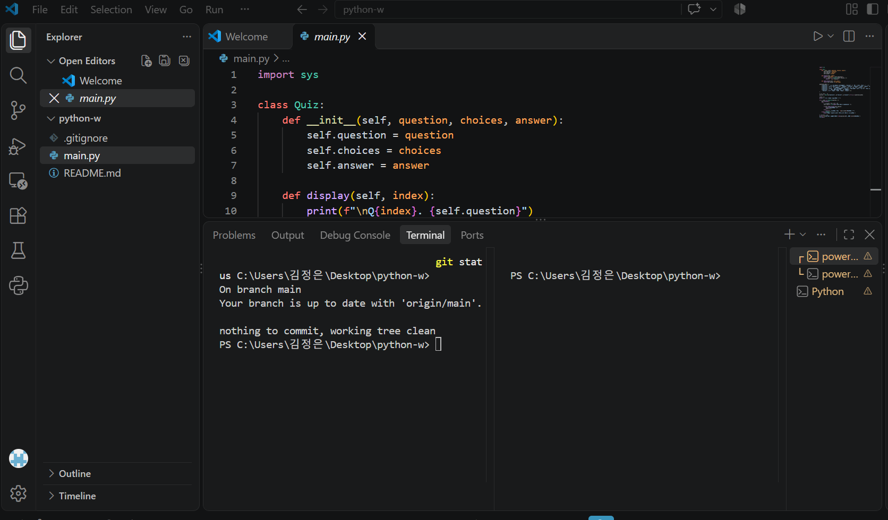

### 9.2 퀴즈 추가

메뉴 2에서 질문과 보기를 입력하는 과정입니다.

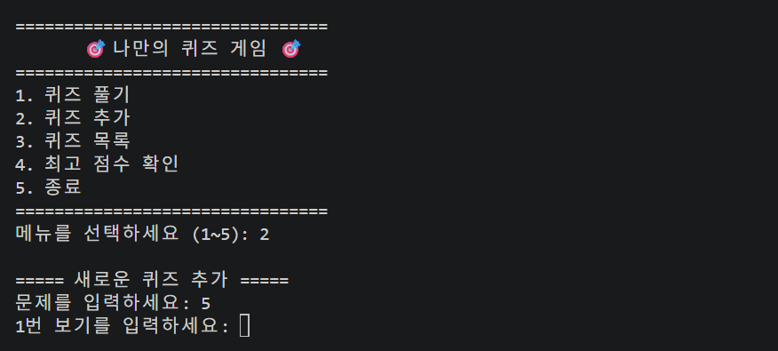

### 9.3 GitHub 저장소

원격 저장소의 프로젝트 파일을 확인합니다.

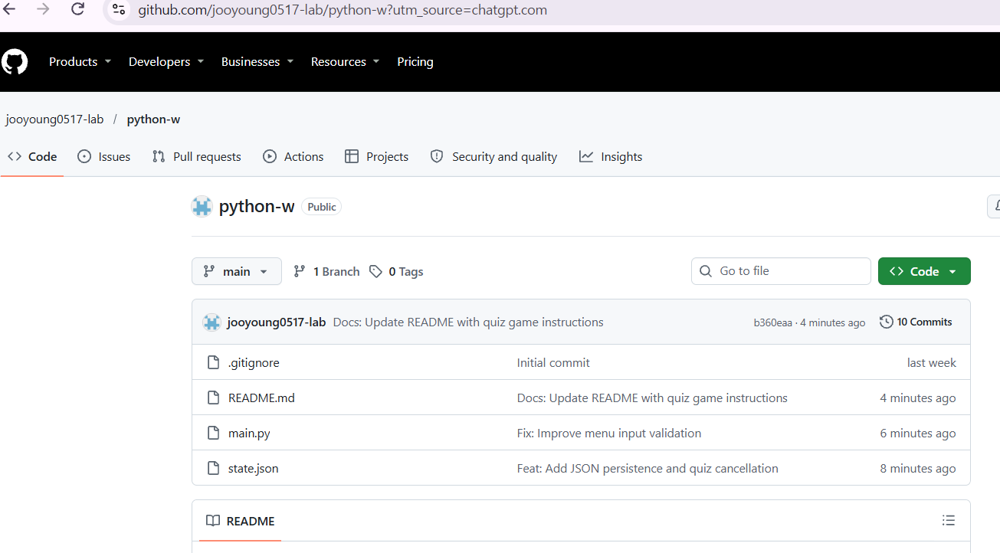

### 9.4 Git 작업 상태

작업 트리 상태 및 경로 이동을 확인합니다.

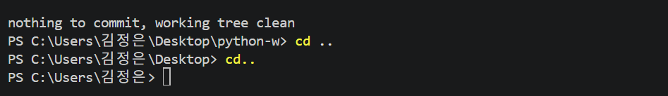

### 9.5 초기 Clone 실습

원격 저장소 복제 결과입니다.

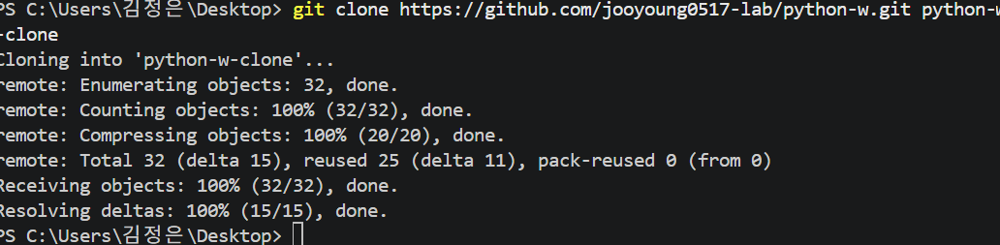

### 9.6 메인 메뉴

저장 데이터 불러오기 메시지와 다섯 메뉴가 표시됩니다.

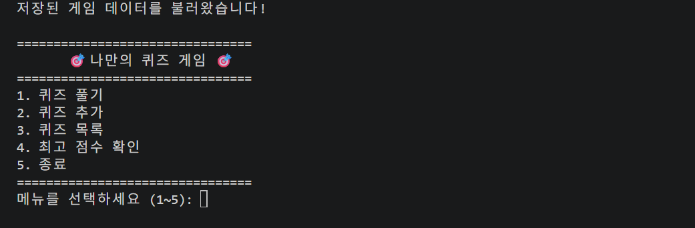

### 9.7 퀴즈 풀이 (1/2)

1~2번 문제의 보기, 입력 및 정답 판정을 확인했습니다.

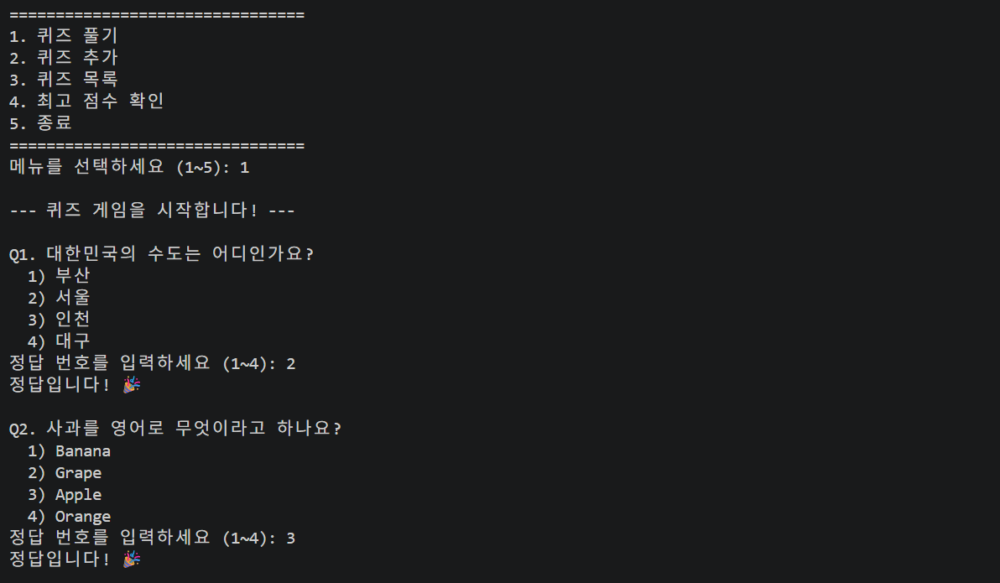

### 9.8 퀴즈 풀이 (2/2)

3~5번 문제 풀이 후 5문제 모두 정답이며 최고 점수가 갱신되었습니다.

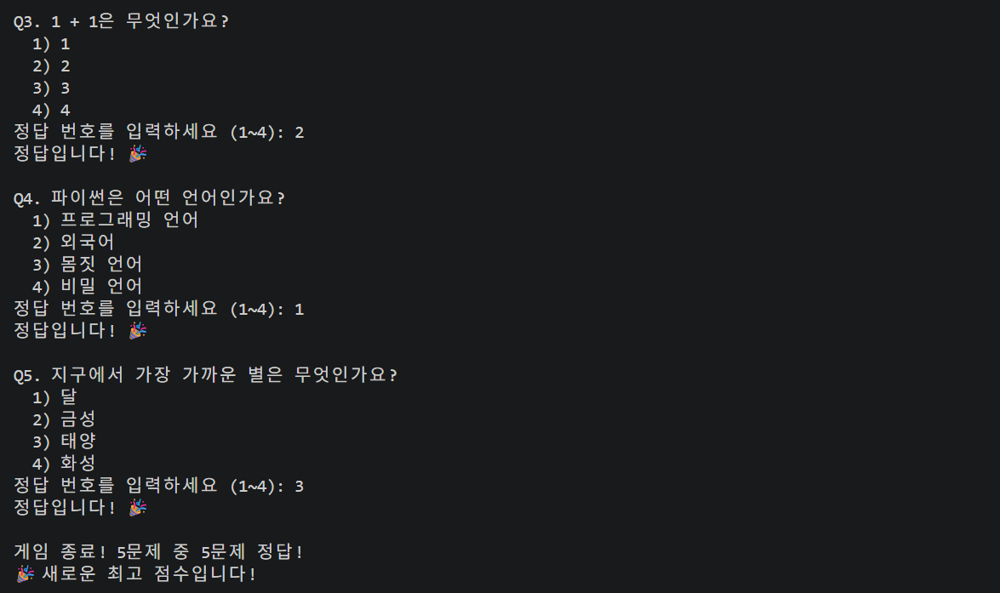

### 9.9 메뉴 입력 검증

9와 a를 입력하면 오류 안내 후 메뉴가 다시 표시됩니다.

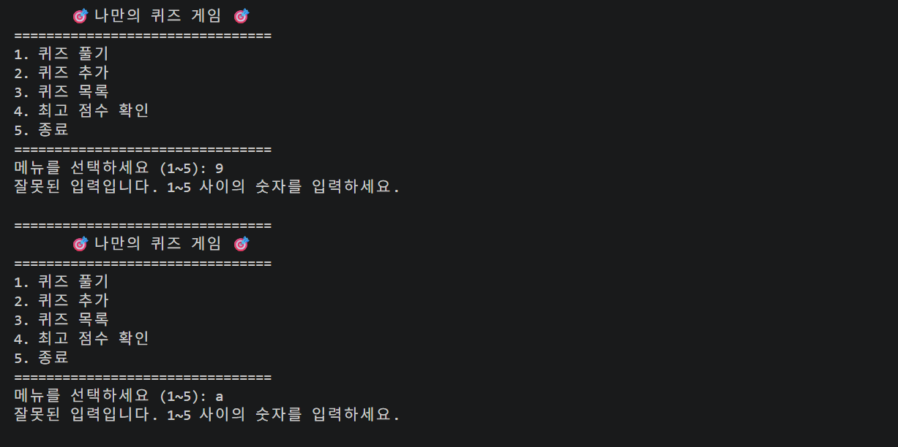

### 9.10 정답 입력 검증

abc 입력 시 숫자 안내, 5 입력 시 범위 안내, 2 입력 시 정답 판정을 확인했습니다.

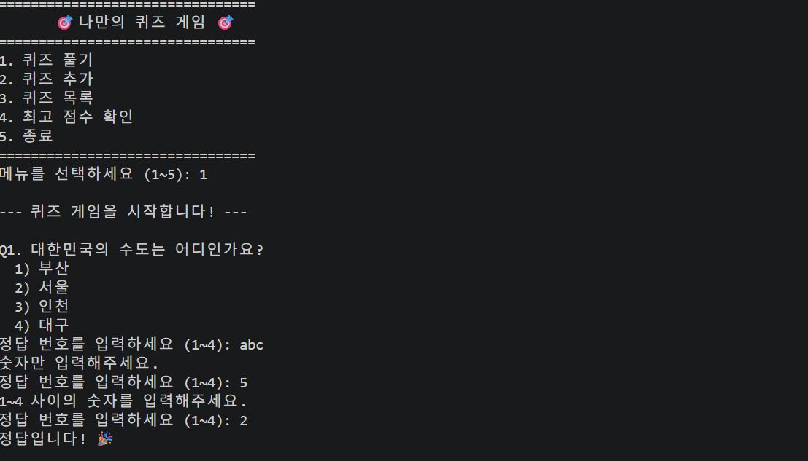

### 9.11 퀴즈 목록

메뉴 3의 목록 확인 실습 자료입니다.

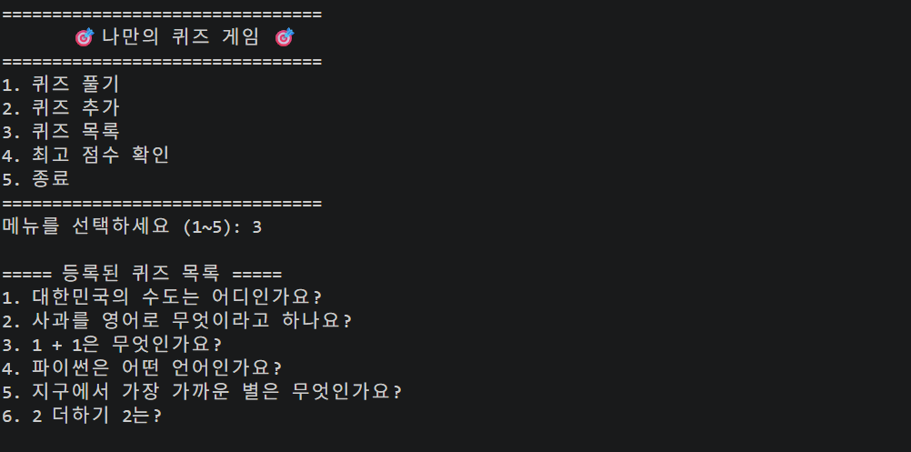

### 9.12 최고 점수

메뉴 4의 최고 점수 확인 실습 자료입니다.

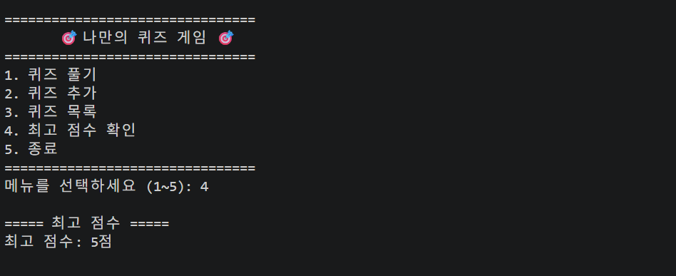

### 9.13 저장 및 종료

메뉴 5의 저장 및 종료 실습 자료입니다.

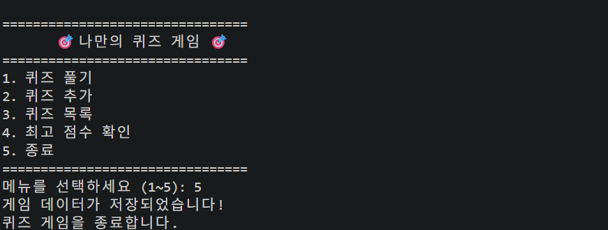

### 9.14 JSON 저장 데이터

기본 문제 5개와 추가 문제 1개, 최고 점수 5점을 확인했습니다. Python으로 JSON을 읽어 문제별 한 줄로 출력했으며 파일은 변경하지 않았습니다.

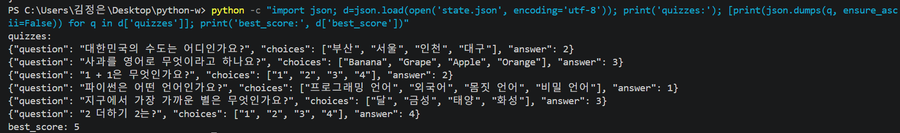

### 9.15 커밋 기록

13개 커밋과 main, feature/quiz-game 및 원격 추적 브랜치를 확인했습니다.

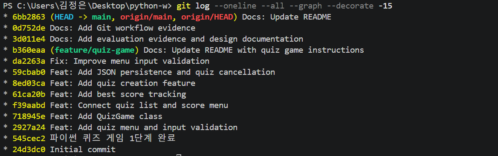

### 9.16 브랜치 및 병합

git branch -a, git branch --merged main, git reflog main 결과로 Fast-forward 병합을 확인했습니다.

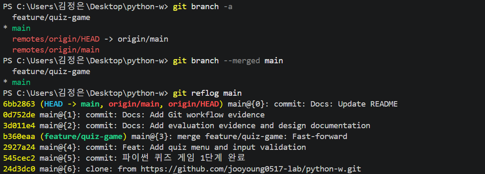

### 9.17 Clone 및 Pull

python-w-test에 새로 복제한 후 git pull origin main을 실행하여 최신 상태임을 확인했습니다.

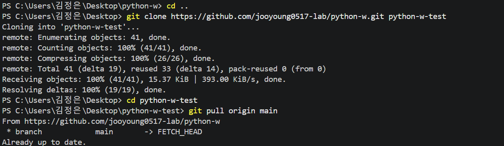

## 10. 개발 과정과 개선 기록

| 단계 | 작업 및 결과 |
|---|---|
| 초기 개발 | 기본 퀴즈 및 메뉴 구성 |
| 기능 확장 | 클래스 설계, 문제 추가, 최고 점수 관리 |
| 데이터 관리 | JSON 저장·불러오기, 문제 추가 취소 |
| 안정성 개선 | 메뉴 입력 검증 및 예외 처리 |
| 버전 관리 | 기능 브랜치 개발, main 병합, 원격 업로드 및 복제 |
| 문서 개선 | 설계 이유, 테스트 절차, Git 증빙 보완 |

### 트러블슈팅 및 검증

- 메뉴 입력 검증을 개선하여 유효하지 않은 메뉴 입력에 대응하도록 수정했습니다(`da2263a`).
- 문제 추가 중 취소할 수 있도록 JSON 저장 기능과 함께 개선했습니다(`59cbab0`).
- 복제한 프로젝트에서 실행 및 Pull 실습을 진행했습니다. `Already up to date.`는 오류가 아니라 최신 상태임을 의미합니다.
- 자동 백업은 아직 구현하지 않았으며 수동 백업 절차를 문서화했습니다.

## 11. AI 사전평가 및 개선 결과

| 구분 | 통과 항목 | 표시 점수 |
|---|---:|---:|
| 최초 평가 | 7 / 20 | 35% |
| 재평가 | 19 / 21 | 90% |

최초 평가 이후 클래스 설계 이유, JSON 구조 및 한계, Git 브랜치 전략과 실습 증빙을 보완했습니다. 재평가에서는 Clone/Pull 스크린샷 누락과 판정 불가 항목이 남았습니다. 이후 Clone/Pull 실행 화면과 커밋·병합 기록을 추가하여 증빙 누락을 보완했습니다. 이번 수정 이후 재평가는 실시하지 않았습니다.

## 12. 프로젝트를 통해 배운 점

### Python 기초 및 객체지향 설계

변수와 자료형, 조건문, 반복문, 함수가 실제 프로그램에서 어떻게 연결되는지 학습했습니다. Quiz와 QuizGame의 역할을 나누면서 데이터와 기능을 함께 관리하는 클래스의 장점과 책임 분리의 필요성을 이해할 수 있었습니다.

### 파일 입출력과 예외 처리

JSON을 통해 실행 간 데이터를 유지하는 방법을 실습했습니다. 잘못된 입력이나 저장 파일의 손상처럼 예상하지 못한 상황에도 대응하는 것이 중요하며, 정상 종료 시 저장하는 방식에는 한계가 있다는 점을 배웠습니다.

### Git과 GitHub

add, commit, push의 차이를 직접 실습하고 브랜치 생성과 병합, clone과 pull을 경험했습니다. 기능별로 커밋을 나누면 변경 이력을 확인하기 쉽다는 점을 학습했습니다.

### 문서화와 프로젝트 수행 소감

비전공자로서 처음에는 코드와 명령어의 의미를 이해하기 어려웠지만 단계별로 실행 결과를 확인하며 전체 흐름을 익혔습니다. 평가 결과를 바탕으로 부족한 문서와 증빙을 보완하면서 기능 구현뿐 아니라 설계 이유와 검증 과정의 기록도 중요하다는 점을 배웠습니다. 앞으로는 각 코드의 역할을 스스로 설명하고 테스트 결과를 체계적으로 기록하는 능력을 키우고자 합니다.

### 실습 결과를 통해 이해한 내용

메뉴에 9 또는 a를 입력하는 실습과 정답에 abc 또는 5를 입력하는 실습을 통해 입력 형식과 허용 범위를 별도로 검증해야 한다는 점을 확인했습니다. 정상 입력으로 돌아오면 게임을 계속 진행할 수 있었습니다. JSON 파일을 직접 읽어 문제 6개와 최고 점수 5점이 저장된 것을 확인하면서 메모리의 데이터와 파일 저장의 차이를 이해했습니다. 또한 `git reflog main`을 통해 Fast-forward 병합은 별도의 병합 커밋이 없어도 실제로 수행되었음을 확인할 수 있다는 점을 배웠습니다.

### Git 명령어 학습 정리

| 명령어 | 역할 |
|---|---|
| `git init` | 로컬 저장소 초기화 |
| `git add` | 커밋할 변경 내용 준비 |
| `git commit` | 로컬 저장소에 변경 이력 기록 |
| `git push` | 원격 저장소에 커밋 업로드 |
| `git pull` | 원격 변경사항을 가져와 현재 브랜치에 반영 |
| `git checkout` | 브랜치 전환 등에 사용 |
| `git clone` | 원격 저장소 복제 |
| `git branch` | 브랜치 생성 및 확인 |
| `git merge` | 다른 브랜치의 변경 이력 통합 |
| `git status` | 작업 상태 확인 |
| `git log` | 커밋 이력 확인 |
